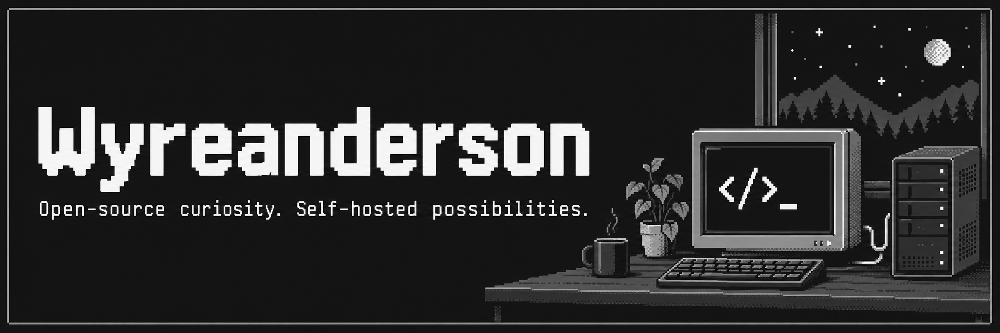

# Hi, I'm Wyreanderson.

I build applications, tools, and practical experiments. I'm interested in web development, automation, infrastructure, and self-hosting.

## About Me

- I learn by building things that solve practical problems.
- My public projects include a local camera tool and a task organization app.
- I value open-source exploration and understanding how things run.

## Featured Projects

### [01 / WyreFi Cam](https://github.com/Wyreanderson/WyreFi-Cam)

A self-hosted tool for sending an iPhone camera feed to OBS over WebRTC, with a local Node.js server.

`TypeScript` · `Node.js` · `WebRTC` · `Vite`

### [02 / stayfokcux](https://github.com/Wyreanderson/stayfokcux)

A mobile-first task organization app with text and audio capture, AI-assisted classification, and collaboration workflows.

`Next.js` · `TypeScript` · `Tailwind CSS` · `Supabase`

<!-- Portfolio feature pending: its public repository is empty as checked on 2026-10-18. Add a description only after repository evidence is available. -->

## Technologies I've Worked With

- **Web:** TypeScript, HTML, CSS, React, Next.js, Tailwind CSS.
- **Local tools:** Node.js, WebRTC, WebSocket, Vite, Vitest.
- **Application services:** Supabase and AI API integrations.

These are technologies used in my public projects, without implying a particular level of expertise.

## Currently Exploring

- Self-hosted tools and local media workflows through WyreFi Cam.
- Text and audio workflows for task organization through stayfokcux.

## GitHub Activity

Follow the code, changes, and experiments in my [public repositories](https://github.com/Wyreanderson?tab=repositories). GitHub displays contribution activity directly on this profile.

## Connect

[GitHub / Wyreanderson](https://github.com/Wyreanderson)
